# Synthagent: Algorithmic Architecture

```mermaid
graph LR
    %% Professional Styling
    classDef ds fill:#f8f9fa,stroke:#adb5bd,color:#333;
    classDef logic fill:#e7f5ff,stroke:#228be6,stroke-width:2px,color:#004085;
    classDef agent fill:#f3f0ff,stroke:#7950f2,stroke-width:2px,color:#4b0082;
    classDef val fill:#fff4e6,stroke:#fd7e14,stroke-width:2px,color:#856404;
    classDef out fill:#ebfbee,stroke:#40c057,stroke-width:2px,color:#155724;

    %% --- 1. Audit & Strategy ---
    Raw([fa:fa-file-csv Raw Input]):::ds --> Audit[fa:fa-magnifying-glass Auditor Suite]:::logic
    Audit -->|Metrics| Ponder{{fa:fa-brain AI Strategist}}:::agent
    Ponder -->|NL Plan| Extract{{fa:fa-scroll Rules Formalizer}}:::agent

    %% --- 2. Orchestration ---
    Extract -->|JSON| Pipeline[fa:fa-gears Pipeline Manager]:::logic
    Raw -.->|Seed| Seed[fa:fa-crosshairs Context Selector]:::logic

    %% --- 3. Parallel Gen Loop ---
    subgraph Engine [Generation & Hardening Engine]
        direction TB
        Split[fa:fa-layer-group K-Fold Split] --> Gen{{fa:fa-robot LLM Generator}}:::agent
        Gen --> Validator[fa:fa-shield-halved Rule Validator]:::val
        Validator -->|Regen| Gen
        Validator -->|Valid| Post[fa:fa-hammer Post-Processor]:::logic
    end
    
    Pipeline --> Split
    Seed --> Gen

    %% --- 4. Analytics & Output ---
    Post --> Eval[fa:fa-chart-simple Evaluation & Benchmarker]:::logic
    Eval --> Results[fa:fa-file-contract Fidelity & ML Reports]:::out
    Results --> Finish([fa:fa-circle-check Augmented Dataset]):::out

    %% Infrastructure
    Pipeline -.->|Parallel| CPU[fa:fa-microchip CPU Engine]
```

### High-Level Technical Summary

1.  **Forensic Audit**: Analyzes Structural, Quality, Fairness, and Privacy metrics using the Auditor Suite.
2.  **AI Strategy**: AI Strategist Agent defines a prescription; Formalizer Agent extracts formal JSON rules.
3.  **K-Fold Engine**: Stratified splitting with representative Seed context sampling for high-fidelity generation.
4.  **Verification Loop**: Pydantic-based re-generation loop ensures 100% adherence to defined constraints.
5.  **Deterministic Hardening**: Post-processor applies Gaussian/Swap noise and numerical precision controls via code.
6.  **Benchmarking**: Validates structural JSD fidelity and downstream ML utility gain across all folds.
