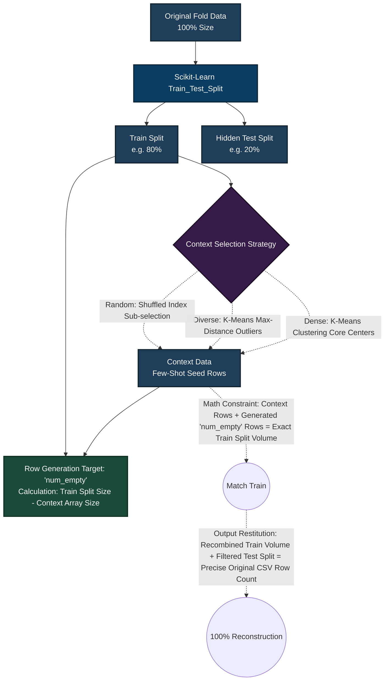
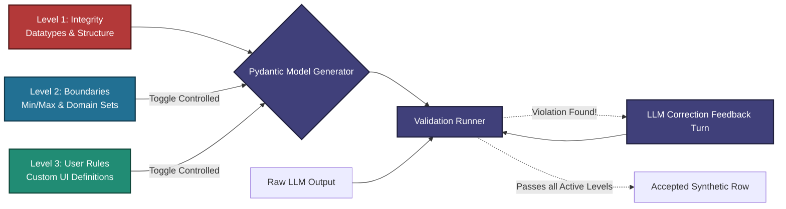
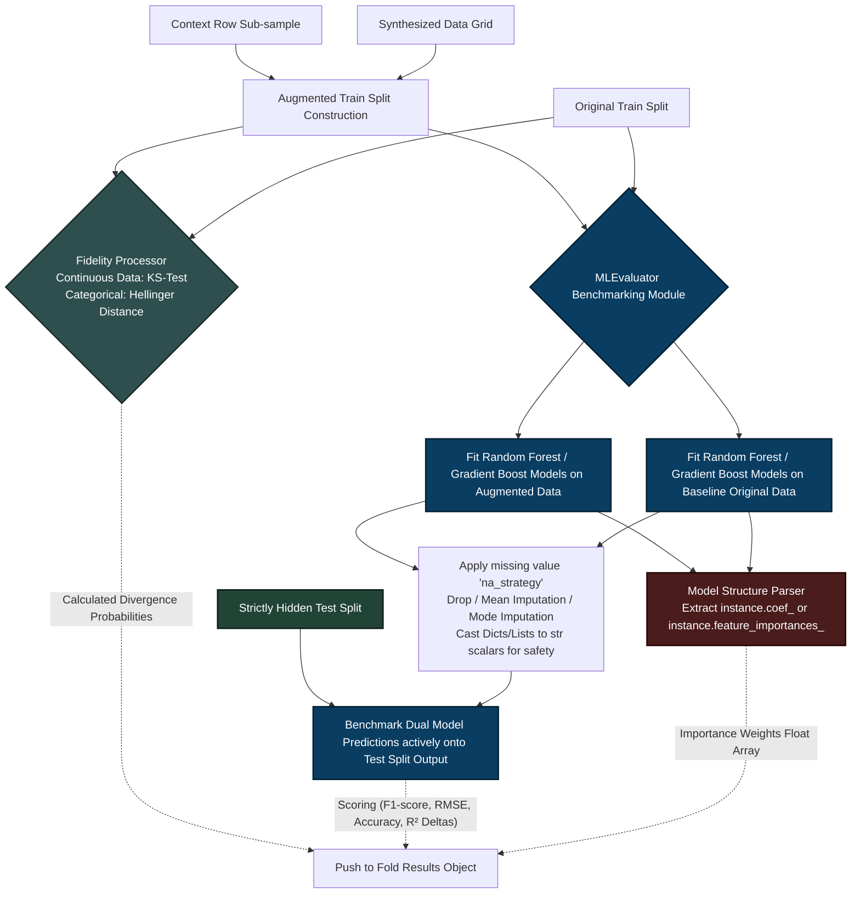
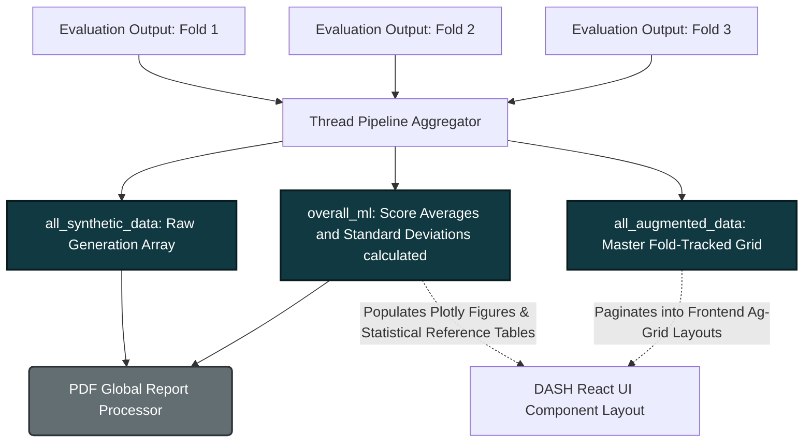

# TabuLLM Pipeline Architecture (Complete System Design)

This document visualizes the exact, exhaustive data flow, token compression, generation algorithms, error repairing, and machine learning benchmarking steps in the TabuLLM codebase.

---

## 0. High-Level Generation Overview
A simplified view of how data travels from your source file to the final verified synthetic output.

---

## 1. Global Pipeline Control & Parallel Processing
How datasets are ingested, evaluated synchronously via multiprocessing, and heavily pre-processed to minimize token expenditure before interacting with the LLM API.

```mermaid
graph TD
    classDef ds fill:#1e1e24,stroke:#444,stroke-width:2px;
    classDef pool fill:#4b184f,stroke:#26052c,color:#fff,stroke-width:2px;
    classDef compress fill:#804000,stroke:#3b1f02,color:#fff,stroke-width:2px;

    T[Incoming Datasets List] --> M(Python Multiprocessing Pool):::pool
    M --> Worker1[Process Node: e.g., dataset_1.csv]
    M --> Worker2[Process Node: e.g., dataset_2.csv]
    
    Worker1 --> KF1{Stratified K-Fold Validation Loop<br/>Folds 1 to K}
    
    KF1 --> Stage1[Split Fold Data into Train/Test]:::ds
    Stage1 --> Stage2[Select Context Seed Rows]:::ds
    
    Stage2 --> MemOpt[Token Compression: 'Compact JSON' Format<br/>Extracts keys into headers, reduces data to strict 2D array]:::compress
    
    MemOpt --> Stage3[Generative LLM Broker Layer]:::ds
    Stage3 --> Stage4[Statistical Distance & Downstream ML Benchmarking]:::ds
    Stage4 --> Store[(Save Complete Fold Object to Session Store)]
```

---

## 2. Train/Test Constraints & Context Sampling Strategies
Visualizing how original data is split algebraically. The system utilizes configurable unsupervised sampling strategies to intelligently pick the `Context Rows` sent to the LLM.

---

## 3. The LLM Target Chunking & Error Recovery Loops
Because deep learning models suffer context collapse, `generate_bulk_data` slices the requirement into fixed `chunk_size` windows, forces autonomous text repairs via `robust_json_loads`, and runs a deterministic top-up recursion if the LLM halts generation prematurely.

```mermaid
sequenceDiagram
    autonumber
    
    participant PM as Pipeline Manager
    participant LC as Chunking Scheduler
    participant AI as Local API / Gemini Client
    participant Out as Verified Data Output

    Note over PM, LC: Task parameters: generate exactly 64 empty rows.
    PM->>LC: call generate_bulk_data(num_empty=64, chunk_size=30)
    
    Note right of LC: 1. Calculate Request Blocks: ceil(64 / 30) = 3 calls
    LC->>LC: Request Queue: [Array Size 30], [Array Size 30], [Array Size 4]
    
    LC->>AI: Chunk 1 Prompt: "Synthesize 30 rows"
    AI-->>LC: JSON [Returns Missing Bracket Syntax Error]
    
    rect rgb(70, 30, 30)
    Note over LC, AI: robust_json_loads fails to parse. Autonomous Repair triggers natively.
    LC->>AI: Repair Prompt: "Fix trailing characters at specific JSON index"
    AI-->>LC: JSON [Returns 28 valid rows] (Halted two rows early)
    end
    
    LC->>AI: Chunk 2 Prompt: "Synthesize 30 rows"
    AI-->>LC: JSON [Returns exact 30 valid rows]
    
    LC->>AI: Chunk 3 Prompt: "Synthesize 4 rows"
    AI-->>LC: JSON [Returns 2 valid rows]
    
    Note right of LC: Current Array Length = 60 rows.<br/>Shortfall Deficit = Target(64) - Current(60) = 4 rows.
    
    rect rgb(20, 50, 40)
    Note over LC, AI: 2. Mandatory Top-Up Generation Loop (Maximum 5 Retries)
    LC->>LC: Calculate missing arrays exact value: 4
    LC->>AI: Shortfall Prompt: "Synthesize exactly 4 missing deficit rows"
    AI-->>LC: JSON [Returns 5 rows]
    end
    
    LC->>LC: Post-Processing Truncation check: Trim 65 rows down to exactly 64 limit.
    LC->>Out: from_compact_json() (Decodes 2D list of lists back to list of dictionaries)
    Out-->>PM: Deliver exactly 64 arrays effectively
```

---

## 4. The Hierarchical Generation & Self-Correction Pipeline
How the system orchestrates automated rule inference, hierarchical merging, and the iterative Pydantic-based repair loop.

```mermaid
sequenceDiagram
    autonumber
    
    participant UI as Dash Components (UI)
    participant INF as RuleInference Service
    participant CB as Generation Callback
    participant LC as LLM Client Broker
    participant VAL as RuleValidator (Pydantic)
    participant AI as Generative LLM (Gemini/Gemma)

    UI->>CB: Click Generate (Toggles: UserRules, Boundaries)
    
    rect rgb(30, 30, 50)
    Note over CB, INF: Static Analysis Phase
    CB->>INF: infer_dataset_rules(original_df)
    INF-->>CB: Hierarchy: Integrity (L1) + Boundaries (L2)
    end
    
    CB->>LC: call generate_bulk_data(rules_hierarchy)
    
    loop Per Chunk (size=30)
        LC->>AI: Initial Generation (System Instructions + Context)
        AI-->>LC: Raw JSON Chunk (e.g., 30 rows)
        
        rect rgb(50, 40, 20)
        Note over LC, VAL: Validation Turn
        LC->>VAL: validate_batch(chunk, active_pydantic_model)
        VAL-->>LC: Found N Violations (e.g., Age > Max OR String in Num field)
        end
        
        break No Violations or Max Retries met
            Note over LC, VAL: Proceed to next chunk
        end
        
        rect rgb(60, 20, 20)
        Note over LC, AI: Self-Correction Turn
        LC->>AI: Fix Prompt (Template: generation_fix.j2 + Detailed Violations)
        AI-->>LC: Corrected JSON Chunk
        end
    end
    
    LC-->>CB: Consolidated Validated Data Records
    CB-->>UI: Update Grid (Mark successful rows in Green)
```

---

## 5. Pydantic Hierarchical Guardrail Layer
Instead of simple heuristics, TabuLLM uses dynamic Pydantic models to categorize and enforce constraints across three layers of strictness.

---

## 5. Downstream Machine Learning & Missing Value Engines
The `MLEvaluator` proves the systemic efficacy of the generated data. It cleans unhashable lists/NaNs (via drop or Mode/Mean imputation), trains XGBoost/Scikit-Learn estimators, extracts structural feature importances, and ultimately runs predictions solely against the unseen Test layer.

---

## 6. Global Artifact Assembly & Visual Rendering Nexus
Decentralized fold outputs are captured by the manager, averaged, and concatenated to form the master output arrays that populate the front-end DASH data grids, scatter-plots, and final PDF audit generator.

