# Synthagent: The Master Architecture Flow

This document contains a monolithic, fully connected, end-to-end flowchart of the entire Synthagent pipeline. It integrates every individual module (from initial multiprocessing ingestion, straight down to final PDF report compilation) into a single continuous visual map.

---

```mermaid
graph TD
    classDef main fill:#1e1e24,stroke:#444,stroke-width:2px;
    classDef algo fill:#0a3d62,stroke:#032030,color:#fff,stroke-width:2px;
    classDef data fill:#1e3d59,stroke:#0f202a,color:#fff,stroke-width:2px;
    classDef llm fill:#4b184f,stroke:#26052c,color:#fff,stroke-width:2px;
    classDef eval fill:#2f4f4f,stroke:#1a2b2b,color:#fff,stroke-width:2px;
    classDef error fill:#bc3a3a,stroke:#4a1212,color:#fff,stroke-width:2px;
    classDef pass fill:#1c7c4b,stroke:#0d4227,color:#fff,stroke-width:2px;
    classDef final fill:#103942,stroke:#091d21,color:#fff,stroke-width:2px;

    Input[Incoming Datasets Queue] --> Pool[Multiprocessing Parallel Engine]:::main
    
    subgraph Fold Processing [1. K-Fold Cross Validation Setup]
        Pool --> Split[Stratified Train/Test Split]:::algo
        Split --> Train[Train Split Fraction]:::data
        Split --> Test[Hidden Test Split Fraction]:::data
        
        Train --> Sampler{Context Sub-Selection}:::algo
        Sampler -.-> |"Dense/Diverse/Random Alg"| Context[Few-Shot Seed Rows]:::data
        Train --> TargetCalc[Target Generator Size:<br/>Train Area - Context Area]:::algo
        
        Context --> Compact[Token Compression: Compact JSON Format]:::algo
        TargetCalc --> Compact
    end
    
    subgraph Generative Engine [2. LLM Generation & Error Management]
        Compact --> Chunk[Calculate Micro-Batches:<br/>ceil TARGET / CHUNK_SIZE]:::llm
        Chunk --> Gen1[LLM Prompt Trigger: 'Synthesize X Arrays']:::llm
        Gen1 --> JSONParse{robust_json_loads Parser}:::algo
        
        JSONParse -.-> |"Syntax / Formatting Error"| Repair[Autonomous Fix Prompt]:::error
        Repair --> JSONParse
        
        JSONParse -.-> |"Valid Parsed Array"| Array[Decode into Dictionary List]:::pass
        
        Array --> Shortfall{Evaluate Array Length vs Target}:::algo
        Shortfall -.-> |"Deficit Caught"| TopUp[Top-Up Trigger: 'Synthesize exact missing deficit']:::error
        TopUp --> JSONParse
        
        Shortfall -.-> |"Target Verified"| Trunc[Post-Processing Length Truncation]:::pass
    end
    
    subgraph Auditing Layer [3. Domain Validation Gates]
        Trunc --> AuditFilters{Numeric/Logical Domain Filters}:::eval
        AuditFilters -.-> |"Fails Physical Rule (e.g., Age < 0)"| RejectRow[Flag Hallucination Data]:::error
        RejectRow --> FilterRow[Discard Array & Request Replacement Pipeline Batch]:::error
        FilterRow --> JSONParse
        
        AuditFilters -.-> |"Passes Matrix Rules"| ValidSynth[Accepted & Verified Synthetic Rows]:::pass
    end
    
    subgraph Evaluation Pipeline [4. Fidelity & Downstream ML Benchmarking]
        ValidSynth --> Augment[Assemble Augmented Train Block:<br/>Context Rows + Synthetic Rows]:::data
        Context --> Augment
        
        Augment --> Fid{KS-Test / Hellinger Calculators}:::eval
        Train --> Fid
        Fid --> Scores[Statistical Divergence Metrics]:::pass
        
        Augment --> ML_Aug["Fit Machine Learning Classifiers<br/>(e.g., Random Forest/XGBoost)<br/>on Augmented Distribution"]:::eval
        Train --> ML_Orig[Fit Machine Learning Classifiers<br/>on Pristine Original Distribution]:::eval
        
        ML_Aug --> NA_Strat[Apply 'na_strategy'<br/>Drop / Mean / Mode Imputations]:::algo
        ML_Orig --> NA_Strat
        
        Test --> Bench[Benchmark Dual Classifier Logits<br/>Solely Against Hidden Test Set]:::eval
        NA_Strat --> Bench
        
        Bench --> PredScores[F1, RMSE, R-Squared, Acc Deltas]:::pass
        
        ML_Aug --> Weights[Parse model.coef_ & importances_]:::algo
        ML_Orig --> Weights
    end
    
    subgraph Global Nexus [5. Aggregation & Artifact Output]
        Scores --> FoldStore[(Serialize Fold Data Dictionary)]:::final
        PredScores --> FoldStore
        Weights --> FoldStore
        Augment --> FoldStore
        ValidSynth --> FoldStore
        
        FoldStore --> Agg[Global Operations Pipeline Aggregator]:::algo
        
        Agg --> Syn[all_synthetic_data Object List]:::final
        Agg --> AugGrid[all_augmented_data Unified Grid]:::final
        Agg --> OvML[overall_ml Averaged Standard Deviations Structure]:::final
        
        Syn --> PDF[PDF Audit Master Engine]:::main
        OvML --> PDF
        
        OvML --> UI[DASH React Frontend Engine UI]:::main
        AugGrid --> UI
    end
```

